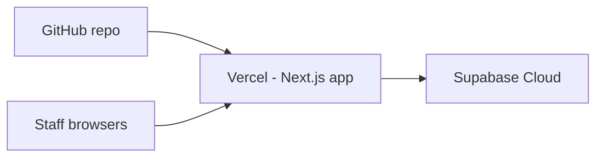

# Deploy BSS Solar Operations Console (Live)

Stack: **Next.js on Vercel** + **Supabase Cloud** (PostgreSQL, Auth, RLS).

Estimated time: ~30 minutes.

---

## Overview



| Layer | Service | Purpose |
| ----- | ------- | ------- |
| Frontend | [Vercel](https://vercel.com) | Hosts the Next.js app |
| Backend | [Supabase](https://supabase.com) | Database, auth, RLS |

---

## Step 1 — Create Supabase project (production database)

1. Go to [supabase.com/dashboard](https://supabase.com/dashboard) → **New project**.
2. Choose a name (e.g. `bss-solar-prod`), region (**South Asia (Mumbai)** is closest to Kerala), and set a strong DB password. Save the password.
3. Wait until the project is **Active**.

### Apply the database schema

**Option A — SQL Editor (simplest)**

1. Open **SQL Editor** → **New query**.
2. Paste the full contents of [`supabase/schema.sql`](supabase/schema.sql) and **Run**.
3. Confirm tables exist under **Table Editor**: `profiles`, `work_orders`, `projects`, `project_milestones`, `service_tickets`.

**Option B — Supabase CLI**

```bash
npx supabase login
npx supabase link --project-ref YOUR_PROJECT_REF
npx supabase db push
```

> Do **not** run `supabase/seed.sql` on production — it is local demo data only.

### Updating an existing production database ⚠️

Each migration can be re-run: it skips or replaces what already exists, and its one data
copy (step 10) never duplicates a payment. So on a DB that was provisioned from
`schema.sql` you can paste and run these files in the **SQL Editor** in order:

1. `supabase/migrations/20260709120000_security_hardening.sql` — **closes the coordinator
   → admin privilege-escalation hole and the self-approval hole**, and makes approval
   atomically create the project. **Highest priority — apply ASAP.**
2. `supabase/migrations/20260709130000_api_role_grants.sql` — API-role grants.
3. `supabase/migrations/20260709140000_dashboard_metrics_and_indexes.sql` — dashboard
   aggregate function + indexes.
4. `supabase/migrations/20260709150000_ticket_no_sequence.sql` — collision-free ticket numbers.
5. `supabase/migrations/20260709160000_list_views.sql` — flattened views that
   back server-side pagination/search (RLS-respecting `security_invoker` views).
6. `supabase/migrations/20260730120000_superadmin_enum.sql` — adds the `superadmin`
   value to `user_role`. **Must run in its own transaction** (PostgreSQL refuses to
   *use* a new enum value in the transaction that added it) — run this file alone,
   then the next one.
7. `supabase/migrations/20260730120100_superadmin_work_order_fields_payments.sql` —
   SuperAdmin role + SuperAdmin-only DELETE policies, the extra work-order columns
   (consumer number, notes, KSEB section, loan bank, two staged payments), the derived
   payment columns on the list views, and the commissioned-unpaid dashboard KPIs.
8. `supabase/migrations/20261010120000_service_engineer_enum.sql` — adds the
   `service_engineer` role value. **Run this file alone**, then the rest (same enum rule
   as step 6).
9. `20261010120100_roles_financing_capacity.sql` — role helpers, self/loan financing,
   numeric `plant_capacity_kw` (generated from the capacity label), work-order owner guard,
   and office-only approval and amounts (see the behaviour changes below).
10. `20261010120200_payments_ledger.sql` — the payments ledger (any number of stages).
    The two fixed payment slots are copied into it (each copy marked by
    `payments.legacy_slot`) and left in place, deprecated; until step 16 a temporary
    trigger mirrors every write to them into the ledger. A re-run copies only a slot that
    has no ledger row — never a second copy, even after the office edited the first — but
    it does restore a migrated payment the Super Admin has since deleted, so do not re-run
    it after deleting one. Once step 16 has run it cannot be re-run at all: the slots it
    copies from are gone.
11. `20261010120300_feasibility_incentives.sql` — KSEB feasibility date + 30-day clock,
    coordinator incentives.
12. `20261010120400_service_engineer_access.sql` — engineer RLS, status-only guard,
    `engineer_tickets()`.
13. `20261010120500_notifications.sql` — notification inbox and the record of alerts
    already sent, push subscriptions (real push services only, 10 devices per user),
    realtime.
14. `20261010120600_list_views_and_metrics.sql` — rebuilt list views + dashboard KPIs.
15. `20261010120700_import_projects_rpc.sql` — the atomic bulk-import function.
16. `20261010130000_drop_legacy_payment_slots.sql` — drops the four deprecated
    first/second payment columns and the temporary mirror trigger from step 10.
    **Run it only once the build that shipped steps 8–15 is live on production** — the
    build before it writes these columns, and every work-order save would fail. It refuses
    (and changes nothing) while a filled slot has no ledger row, naming the work orders; if
    their ledger rows were deleted on purpose, clear those slots and run it again.
17. `20261022120000_sale_coordinators.sql` — **shared coordinators**: a sale can have up
    to five coordinators (`work_order_coordinators`; the first one stays on
    `work_orders.coordinator_id`), each with a private incentive row
    (`coordinator_incentives`), membership-based RLS, `set_work_order_coordinators()` and
    the two directory functions. It gives every existing work order its coordinator as
    first member and moves each project's incentive to that coordinator's own row; a
    re-run never overwrites an incentive the office has set since. It holds a short lock
    on `work_orders` and `projects` (writes wait, reads carry on) and gives up after
    10 seconds rather than queueing the app behind a long transaction.
18. `20261022120100_custom_plans_and_cancellation.sql` — the plan type (`solar` or
    `custom`: a sale that is not a kW plant, with one Handover milestone and no KSEB
    feasibility) and cancelled / refunded projects with their remarks. Every existing row
    stays solar and live.
19. `20261022120200_list_views_and_metrics.sql` — the list views and dashboard KPIs for
    shared coordinators, custom plans and cancellation. Every old view column keeps its
    name, type and position. It drops and re-adds the generated column
    `work_orders.plant_capacity_kw` (a table rewrite that takes seconds at this size, and
    needs nothing newer than PostgreSQL 12).
20. `20261022120300_import_projects_v3.sql` — the importer for resolved coordinators, plans
    and cancelled / refunded rows. Same signature as before; the previous build's rows
    (`coordinator_email`) still import.

Steps 17–20 are **expand-only**: the currently-deployed build keeps working against them
(see *Behaviour changes* below). A later release removes what they deprecate — the
project's own coordinator and incentive columns and the temporary trigger that mirrors the
old build's incentive writes into the new table — once this build is confirmed live; keep
that gap short too.

Or, if the project is linked to the CLI, run `npx supabase db push` (the CLI applies
each file in its own transaction, so the enum rule takes care of itself).

#### Behaviour changes to be aware of

The schema is applied *before* the new code deploys, so for a while the currently-deployed
build runs against it:

- Migration 7 makes **DELETE SuperAdmin-only** on `work_orders`, `projects` and
  `profiles`. In the gap an admin using the currently-deployed build can still press
  **Delete** — RLS filters the row out, so nothing is deleted. The new build detects the
  zero-row delete and reports it instead of showing a false success.
- Migration 9 makes **the amounts of an approved work order office-only**. A coordinator
  still edits everything on a pending work order and the details of an approved one, but
  changing the advance or the total cost (or, in the old build, a first/second payment)
  once the order is approved or rejected is refused with *"Only the office can change the
  amounts of an approved or rejected work order"*. It also refuses a coordinator creating
  a work order in any status but pending — the app never offered that.
- Migration 10 keeps **payments entered in the old build**: it still writes the deprecated
  first/second payment fields, and a temporary trigger copies every such write into the
  payments ledger (as *Migrated: first/second payment*), so nothing recorded in the gap is
  lost.
- Migration 16 is the exception to the order above: it is a **contract** step, safe only
  once the build that stopped using the payment slots is already live. It ships in a later
  release than migrations 8–15, so CI applies it only after that build is in production.

- Migrations 17–20 keep **the old build working**: a work order logged by the old build
  gets its coordinator as first member; its project settings page keeps writing the
  project's own incentive columns, which a temporary trigger carries to that coordinator's
  own incentive row; the old import still takes `coordinator_email`. What the old build
  does not show: other coordinators on a shared sale (a partner can *see* the work order
  and project but gets no Edit button), a cancelled or refunded badge (those projects are
  still left out of the dashboard KPIs, and are no longer "payment pending"), and a custom
  plan's details (it shows the label in place of a capacity). Its import row for a
  commissioned project with no `commissioned_on` now leaves the date unknown instead of
  stamping the import time.
- **Rolling back** the build after it has gone live keeps every sale, payment and
  incentive row, but it is not entirely hands-off: the old build sees the first coordinator
  as the owner, a shared sale stays visible to its partners, and cancelled projects show no
  badge. Its project page reads the deprecated incentive columns, which the new build no
  longer updates, so it may show a stale or blank incentive — and **editing the incentive
  fields on that page (amount or paid date) overwrites the real incentive** of the sale's
  first coordinator, and clearing them clears it. A save of Project settings that leaves
  those two fields as they were (say, to correct the feasibility date) changes nothing:
  the temporary trigger carries over only a real change. After a rollback, tell the office
  not to touch the incentive fields on the old page until the new build is back; a
  partner's own incentive is never affected.
- **What sharing a sale exposes.** Partners on a sale can read each other's profile row —
  name, role and phone — and nobody else's. A partner is not asked: a coordinator can add
  any other *coordinator* to a pending sale they logged, which shows that person's profile
  to everyone else on the sale and puts the sale on their list. The database refuses a
  coordinator adding an admin or the Super Admin. The office can take a partner off again
  (**Change** next to the coordinators on the work order's page); the database refuses
  only while an incentive is set for them, so clear that first.

Keep the gap short by merging `master → production` once CI is green.

#### Before merging the shared-coordinators release

CI applies migrations 17–20 to production on merge, so check two things in the production
**SQL Editor** first and write the results in the PR:

1. **The PostgreSQL version** — `show server_version;`. The migrations need only
   PostgreSQL 12 or later (nothing else in the repo pins production's version), so this is
   a record, not a gate; if it is older than 12, stop and ask.
2. **No long-running transaction** — the migrations wait at most 10 seconds for their
   table locks, and anything that has been open for a while would make them fail instead
   of stalling every request queued behind them:

   ```sql
   select pid, now() - xact_start as open_for, state, left(query, 80) as query
   from pg_stat_activity
   where xact_start < now() - interval '1 minute'
   order by xact_start;
   ```

   No rows is what you want. If the `migrate-production` job still fails with *canceling
   statement due to lock timeout*, nothing was applied (each file is one transaction):
   re-run the job.

Also confirm `node supabase/scripts/check-schema-sync.mjs` and `npm run db:types` are
clean locally (CI checks both), and take a backup (**Database → Backups**).

### Collect API keys

**Project Settings → API**:

| Supabase dashboard label | Vercel env variable |
| ------------------------ | ------------------- |
| **Project URL** | `NEXT_PUBLIC_SUPABASE_URL` |
| **Publishable key** (`sb_publishable_…`) | `NEXT_PUBLIC_SUPABASE_ANON_KEY` |
| **Secret key** (`sb_secret_…`) | `SUPABASE_SERVICE_ROLE_KEY` |

> Older projects may label these `anon` and `service_role` — same mapping applies.

Keep the **secret / service_role** key private — server-only (Team → Add Member).

---

## Step 2 — Configure Supabase Auth

1. **Authentication → Providers → Email**  
   - Enable Email provider.  
   - **Disable “Allow new users to sign up”** (staff accounts are created by admin only).

2. **Authentication → URL configuration**:  
   - **Site URL**: `https://app.bss-solar.com`  
   - **Redirect URLs**: add  
     - `https://app.bss-solar.com/**`  
     - `http://localhost:3000/**` (optional, for local testing against prod DB)

3. For faster onboarding, you may disable **Confirm email** under Email provider until staff accounts are set up.

4. **Harden auth** (defense-in-depth for the app-layer throttling):
   - **Authentication → Rate Limits / Attack Protection** — keep the default
     sign-in rate limits enabled; turn on **CAPTCHA** (hCaptcha/Turnstile) if exposed publicly.
   - **Authentication → Policies** — set a **minimum password length of 12** to match the
     app's Add-Member validation.

---

## Step 3 — Deploy the Next.js app on Vercel

1. Go to [vercel.com/new](https://vercel.com/new) → **Import** `GSARYAPUTHRAN/bss-solar` from GitHub.
2. Framework preset: **Next.js** (auto-detected).
3. **Environment variables** (Settings → Environment Variables) — add all three for **Production** (and Preview if you test PRs):

| Name | Value |
| ---- | ----- |
| `NEXT_PUBLIC_SUPABASE_URL` | `https://YOUR-PROJECT-REF.supabase.co` |
| `NEXT_PUBLIC_SUPABASE_ANON_KEY` | your `sb_publishable_…` key |
| `SUPABASE_SERVICE_ROLE_KEY` | your `sb_secret_…` key |

   **Optional — notifications.** The app works without these; each one switches a
   feature on:

   | Name | Enables | How to get it |
   | ---- | ------- | ------------- |
   | `NEXT_PUBLIC_VAPID_PUBLIC_KEY` | Browser push notifications | `node scripts/generate-vapid-keys.mjs` prints a pair |
   | `VAPID_PRIVATE_KEY` | (pairs with the public key — **secret**) | same command |
   | `VAPID_SUBJECT` | Contact for push services (defaults to the company email) | e.g. `mailto:bsssolarkerala@gmail.com` |
   | `CRON_SECRET` | The daily feasibility alert job (`/api/cron/daily`) | any long random string, e.g. `openssl rand -hex 32` |

   Without the VAPID keys, notifications still appear in the in-app bell — only the
   phone/desktop push is off. Without `CRON_SECRET` the daily job refuses every call
   (fails closed), so feasibility expiry alerts are not sent. Vercel calls the job at
   08:00 IST (`vercel.json`) and sends the secret automatically. **Generate the VAPID
   pair once and never rotate it casually** — every existing device subscription is
   tied to the public key and would have to re-enable push.

4. Click **Deploy** and wait for the build to finish.
5. Add custom domain **bss-solar.com** under **Settings → Domains** (already done if purchased on Vercel).
6. Return to Supabase **URL configuration** (Step 2):
   - **Site URL**: `https://app.bss-solar.com`
   - **Redirect URLs**: `https://app.bss-solar.com/**`
7. **Redeploy** after adding env vars (Deployments → ⋯ → Redeploy).

### Redeploys

Every push to the **`production`** branch auto-deploys when Vercel is configured to use that branch. Merge `master` into `production` when you are ready to release.

### CI quality gate (recommended branch protection)

`.github/workflows/ci.yml` runs on every PR to `master`/`production`: typecheck,
lint, unit tests, a production build, RLS/DB integration tests (against a
throwaway local Supabase), and Playwright E2E. To make green CI a merge
requirement:

1. **GitHub → Settings → Branches → Add rule** for `master` **and** `production`.
2. Require a pull request before merging; require the **CI** status checks
   (`quality`, `integration`, `e2e`) to pass; disallow direct pushes.
3. Release by merging `master → production` **only after CI is green**, so the
   branch Vercel deploys can never contain unverified code.

### Automatic production migrations

Vercel builds the Next.js app but does **not** run database migrations. The CI
workflow includes a `migrate-production` job that runs **only after the whole
pipeline passes on `master`** and applies pending migrations to the production
Supabase project with `supabase db push`. The migrations are additive
(columns/views/functions/triggers/grants), so the schema is made ready while the
currently-deployed code keeps working; you then merge `master → production` to
ship the code that uses it.

> Where a migration also *tightens* a policy — as the SuperAdmin release does for
> `DELETE` — the old code fails closed in the gap rather than misbehaving. See
> [Behaviour changes to be aware of](#behaviour-changes-to-be-aware-of) and
> keep the gap short by merging to `production` as soon as CI is green.

Enable it once by adding three **repo secrets**
(Settings → Secrets and variables → Actions):

| Secret | Where to get it |
| ------ | --------------- |
| `SUPABASE_ACCESS_TOKEN` | Supabase → Account → Access Tokens |
| `SUPABASE_DB_PASSWORD` | The database password you set when creating the project |
| `SUPABASE_PROJECT_REF` | Supabase project ref (e.g. from the project URL) |

Recommended release flow once secrets are set:

1. Merge work into `master` → CI runs; on green, `migrate-production` applies
   migrations to the prod DB automatically.
2. Merge `master → production` → Vercel builds and deploys the code.

> Keep every migration **backward compatible** (additive, or safe against the
> currently-deployed code), since the schema is applied before the new code.

> **Private repo on Hobby:** Git pushes only deploy if the **commit author email** matches your GitHub/Vercel account. If you see *“commit author did not have contributing access”*, fix the email (below) or deploy via CLI.

```powershell
# One-time: use the email on your GitHub account (Settings → Emails)
git config user.email "YOUR-GITHUB-EMAIL"
git config user.name "gsaryaputhran"

# Then commit and push as usual
git checkout production
git merge master
git commit --allow-empty -m "Deploy with correct author"
git push origin production
```

**CLI deploy (bypasses git author check):**

```powershell
npx vercel login
npx vercel link --project bss-solar --yes
npx vercel --prod
```

---

## Step 4 — Create the first admin user

There is no public sign-up page. Create the first admin manually:

1. **Supabase → Authentication → Users → Add user**  
   - Email: e.g. `admin@bsssolar.in`  
   - Password: strong password  
   - Check **Auto confirm user**

2. **SQL Editor** — run [`supabase/production-bootstrap.sql`](supabase/production-bootstrap.sql) after editing the email inside the file.

3. Sign in at `https://app.bss-solar.com/login`.

4. Use **Team → Add Member** to create coordinator accounts.

5. **Appoint the Super Admin** — the highest privilege, and the only role that can
   delete users, projects and work orders.

   This role is **not assignable from the app by anyone** (a DB trigger rejects it
   even for the Super Admin), so it is done in SQL:

   1. **Authentication → Users → Add user** — the Super Admin's email, a strong
      password you choose, **Auto confirm user** ticked.
   2. **SQL Editor** — run the *Super Admin* section of
      [`supabase/production-bootstrap.sql`](supabase/production-bootstrap.sql) after
      editing the email inside it.
   3. Sign in and confirm the Team page shows the role as a locked **Super Admin**
      badge with no dropdown, and that Delete appears on team/work-order/project pages.

   The same statement is how you move the seat later (demote the current holder in the
   same run — the unique index refuses a second) and how you recover if the account is
   lost. Nothing in the UI can do it.

6. **Add service engineers** — Team → Add Member → role **Service Engineer**. They sign
   in on their phones, land on *Service Tickets*, and see only tickets assigned to them.

---

## Fresh start: wipe business data, then bulk-import ⚠️

Use this once, to replace trial data with the real project list. It is **destructive and
irreversible** — take a backup first (**Database → Backups**, or `pg_dump`).

Order matters: the scripts and the importer both rely on this release's schema, so
**deploy this release first** (migrations applied, new build live).

There are two scripts. Pick by what you want to keep:

| Script | Deletes | Keeps |
| ------ | ------- | ----- |
| [`wipe-business-data.sql`](supabase/scripts/wipe-business-data.sql) | every work order, project, milestone, payment, service ticket, who shares each sale, every coordinator's incentive, every notification | **every account** (sign-ins, names, roles) and every push subscription |
| [`reset-business-data.sql`](supabase/scripts/reset-business-data.sql) | the same, **plus every account not in its keep-list** | the accounts you list |

Each has a read-only **preview** next to it. Both are one atomic block: they abort without
deleting anything on a typo, a missing admin or a table they do not know about, and roll
everything back if their final check fails.

### The usual path — wipe, keep the team, import

1. **Preview.** Paste [`supabase/scripts/wipe-business-data-preview.sql`](supabase/scripts/wipe-business-data-preview.sql)
   into the SQL Editor. It changes nothing. Read the *verdict* (`READY` or `WOULD ABORT`),
   the row count of every table that will be emptied, and the accounts that stay.
2. **Run the wipe.** Open [`supabase/scripts/wipe-business-data.sql`](supabase/scripts/wipe-business-data.sql)
   and type exactly `WIPE ALL BUSINESS DATA` into the `confirm` line at the top — the
   script ships with it empty, so it can never run by accident — then run it. The
   result lists every table at 0, the accounts by role and the push subscriptions kept.
   Do not save the edited phrase back into the repository.
3. **Make sure every account the sheet names exists.** Team → Add Member for anyone
   missing (coordinators and the office account that owns the office's own sales). The
   importer reads the sheet's **`coordinator`** cell (the old `coordinator_email` and
   `coordinators` headers still work) as an e-mail or a name: the exact full name, or a
   first name that matches exactly one account (`Ravi` finds *Ravi Kumar* only if no other
   Ravi exists; `Ravi K` narrows it). Several people on one sale are written
   `Ravi + Abhijith`, `Ravi & Abhijith`, `Ravi, Abhijith` (up to five; the first is the
   coordinator who logged it). A spelling that is close but not exact — `Abhijit` for
   *Abhijith* — is **never** guessed: it fails with a "did you mean". An account created
   without a name has its e-mail as its name, and the importer flags it. The Team page
   cannot rename an account, so either create the account through **Team → Add Member**
   (which asks for a name) or set the name in the SQL Editor, using the account's id from
   **Authentication → Users**:

   ```sql
   update profiles set full_name = '…' where id = '…';
   ```

   Service engineers cannot own a sale.
4. **Check file.** Onboarding → paste or upload the CSV → **Check file**. This validates
   everything and **writes nothing**. Read the *Coordinator matches* panel (problems come
   first: every written reference and the account it resolved to), the file-level warnings
   (rows with no consumer number, which would be imported again on every upload; two rows
   that look like the same sale; blank order dates) and each failed row, then fix the
   sheet and check again. Leave **Default coordinator** at *No default* unless the rows
   with a blank coordinator cell really belong to one person: with no default, a blank
   cell fails instead of silently giving the sale to whoever is uploading, and a row that
   falls back to the default cannot carry an incentive.
5. **Import projects.** Same screen, same file. Every row is imported all-or-nothing; the
   result table lists imported / skipped / failed rows, with the coordinators each sale
   ended up with. *Download failed rows* gives a CSV of exactly the rows to fix. **Fix and
   re-upload that file, not the original.** Leave **Skip rows whose consumer number already
   exists** ticked: it skips a row whose KSEB consumer number is already in the database,
   but only rows **with** a consumer number are protected — a row without one is imported
   again every time it is uploaded.
6. **Spot-check** the dashboard counts against the sheet, a shared sale (both coordinators
   see it), a custom plan and a cancelled or refunded project.

### Keeping only some accounts — reset

If trial accounts must go too, use the reset instead of the wipe:

1. Paste [`reset-business-data-preview.sql`](supabase/scripts/reset-business-data-preview.sql) (it
   lists the accounts that will be kept and deleted and the row counts that will go).
2. **Edit the keep-list** at the very top of
   [`reset-business-data.sql`](supabase/scripts/reset-business-data.sql) — the emails of every
   account to keep (it is pre-filled with `admin@bsssolar.in` and `gsputhran@yahoo.com`) —
   and put the same list in the preview. Everything else goes.
3. **Run it.** If any keep-list email does not exist (a typo that would otherwise delete the
   account you meant to keep), if the list is empty, or if no kept account is an
   admin/Super Admin, it aborts and **deletes nothing**.
4. **Re-create staff** (step 3 above), then continue from *Check file*.

### What the importer accepts (beyond the template)

- **Plan.** `plan_type` is `solar` (default) or `custom`. A custom plan is a sale that is
  not a kW plant — write what was sold in `plant_capacity` (`1 panel`, `Inverter + panel`);
  it has no KSEB feasibility date and a single *Handover* step (`current_stage` blank, or
  `completed` when it is already handed over). A solar capacity needs a unit on its first
  number (`3kW`, `5 kWp`, `3000W`); `1 panel` there is refused with a pointer to
  `plan_type`.
- **Cancelled or refunded.** `cancellation` (`cancelled` / `refunded`), `cancelled_on` and
  `cancellation_remarks` (put the refund amount, date and mode here). Such a row needs its
  `order_date`; a blank `plant_capacity` is stored as *Not recorded* and a blank
  `total_cost` as 0. The feasibility clock stops on `cancelled_on`, which is required when
  the row has a `feasibility_date`.
- **Amounts** may be sums: `235000+23500`.
- **Dates are never invented.** A commissioned row with no `commissioned_on` is imported
  with its date *not recorded* (a commissioned row that has a feasibility date must give it).
- **Incentives** (`coordinator_incentive`, `incentive_paid_on`) are accepted only on a row
  whose single coordinator is named in the cell; on a shared sale set each person's
  incentive on the project page afterwards.

---

## Step 5 — Smoke test (production)

| Check | How |
| ----- | --- |
| Login | Admin signs in at `/login` |
| Dashboard | Admin sees KPIs at `/` |
| Work order | Coordinator creates one; admin approves |
| Projects board | Cards appear in correct Kanban columns |
| Team | Admin adds a coordinator at `/team/new` |
| PDF | Open a ticket → Download PDF |
| Work-order edit | Coordinator edits their own order; the project shows the change |
| Payments | Set a total + partial payments → `Balance` column and badge update |
| Commissioned · Unpaid | Dashboard KPI links to the filtered project list |
| Delete | Only the Super Admin sees Delete on team/work orders/projects |
| Seat locked | The Super Admin's row shows a badge, not a role dropdown, for everyone |
| Payments ledger | Record 4+ payments on a project; stages number 1…N and the balance falls |
| Financing | Set a work order to *Bank loan*; the badge shows on the work order and project |
| KSEB & feasibility | Set a feasibility date; the project shows valid-until, days left, fees incl. GST |
| Incentive | Office sets an incentive; the coordinator sees it but cannot edit it |
| Service engineer | Assign a ticket; the engineer sees only it, can Start / Complete, nothing else |
| Notifications | The bell counts new items; *Enable push* on a phone, approve a work order, the phone buzzes |
| Daily job | `curl -H "Authorization: Bearer $CRON_SECRET" https://app.bss-solar.com/api/cron/daily` returns a JSON report |
| Shared coordinators | A coordinator adds a partner to a new work order; the partner sees it, edits its details, and gets its updates; a coordinator cannot add an admin; only the office can change the team after approval |
| Private incentives | The office sets two different incentives on a shared project; each coordinator sees only their own |
| Cancelled / refunded | The office marks a project refunded with remarks: it leaves the active pipeline and KPIs, its balance stops counting as outstanding, and *Reinstate* brings it back |
| Custom plan | Create a *Custom plan* ("Inverter + panel"): no KSEB estimate, one *Handover* step, *Mark handed over* completes it |
| Check file | Onboarding → *Check file* on a sample sheet reports coordinator matches and warnings, and creates nothing |

---

## Custom domain

Production URL: **https://app.bss-solar.com** (subdomain of `bss-solar.com` registered on Vercel).

Update Supabase **Site URL** and **Redirect URLs** to `https://app.bss-solar.com` only.

## Running costs (typical)

| Service | Tier | Monthly | Notes |
| ------- | ---- | ------- | ----- |
| **Vercel** | Hobby (free) | **$0** | Enough for a small internal ops app |
| **Supabase** | Free | **$0** | 500 MB DB; pauses after ~7 days idle on free tier |
| **Domain** | bss-solar.com | **~$0.94/mo** | ~$11.25/year renewal on Vercel |

**Estimated total today: ~$0/month** + domain renewal (~$11/year).

Upgrade when you outgrow free limits: Supabase Pro **$25/mo**, Vercel Pro **$20/mo** per seat.

---

## Troubleshooting

| Issue | Fix |
| ----- | --- |
| Login redirects loop | Supabase Site URL must match your Vercel URL exactly |
| “Invalid API key” | Re-copy anon key; redeploy Vercel with correct env vars |
| Add Member fails | `SUPABASE_SERVICE_ROLE_KEY` missing or wrong on Vercel |
| Coordinator sees dashboard | Clear cache; ensure latest `master` is deployed |
| Git push blocked on Hobby private repo | Commit email must match GitHub/Vercel account, or use `npx vercel --prod` |
| RLS blocks data | User must exist in `profiles`; check role is `admin` or `coordinator` |
| `migrate-production` fails with *lock timeout* | A long transaction held a table lock; nothing was applied. Run the *pg_stat_activity* check under *Before merging*, then re-run the job |
| A coordinator no longer sees a sale | They were taken off it by the office (they are told); the sale itself is untouched |
| Import says a coordinator is "not a coordinator or office account" | The name or e-mail matches no account (or matches a service engineer). Fix the spelling, or add the account on the Team page first — close spellings are suggested, never guessed |

---

## CLI quick reference

```bash
# Local against production DB (use prod keys in .env.local — be careful)
npm run build          # verify production build
npx supabase db push   # push migration changes to linked project
npx vercel --prod      # deploy from CLI (after vercel login + link)
```
